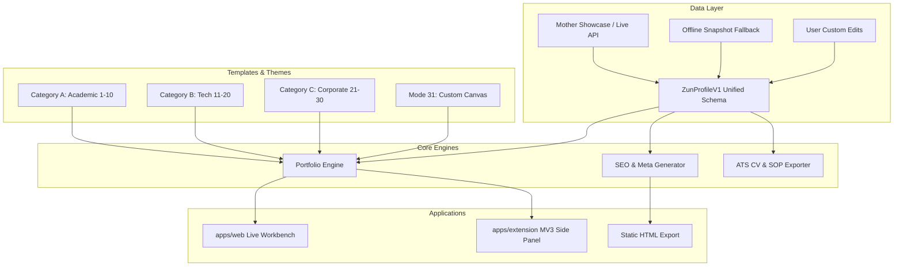

# ZunDeck Architecture Guide

## Overview

ZunDeck is structured with a strict separation of concerns between reusable core logic (`core/`), user-facing applications (`apps/`), automation scripts (`scripts/`), and test harnesses (`tests/`).

---

## Subsystems

### 1. `core/schema/`
- **`profile-schema.js`**: Defines the authoritative `ZunProfileV1` contract powering Portfolios, CVs, and SOP letters bidirectionally. Provides schema validation, item normalization, and default profile generation.

### 2. `core/data/`
- **`mother-showcase.js`**: Fetches the live public portfolio data from `https://mdnafizurrahman8024.github.io/data/portfolio-data.json`, maps it to `ZunProfileV1`, and resolves media assets to the remote CDN without storing local heavy binaries.
- **`mother-fallback.json`**: An offline snapshot (~35 KB text-only) ensuring zero-dependency local operation when disconnected.

### 3. `core/templates/` & `core/engines/`
- **`portfolio-catalog.js` & `portfolio-engine.js`**: 30 role-based templates across Academic, Tech, and Corporate sectors + Custom Canvas. Compiles `ZunProfileV1` into standalone responsive HTML/CSS.
- **`cv-catalog.js` & `cv-engine.js`**: 30 CV & Resume templates featuring Flagship Academic CV, Europass CEFR layout, and corporate standards with vector print CSS.
- **`cv-profile-manager.js`**: Multi-CV targeted profile manager with bidirectional sync between master portfolio and role-specific CV profiles.
- **`ats-xray.js`**: ATS compliance inspector analyzing linear plain-text stream, candidate metrics, and parsing diagnostics.
- **`letter-studio.js` & `letter-prompts.js`**: 4 writing modes (SOP, Motivation Letter, Cover Letter, Cold Email), deterministic Offline Smart Template Assembler, and Zero-Fabrication Authenticity Guardrail.
- **`seo-generator.js`**: Produces OpenGraph, Twitter Card, and JSON-LD Person structured data.

### 4. `core/exporters/` & `core/ui/`
- **`pdf-print-exporter.js`**: Vector A4 print styling and iframe print trigger.
- **`docx-exporter.js` & `letter-exporter.js`**: Zero-dependency OpenXML Word (`.docx`) file generator producing valid zip archives for CVs and Letters.
- **`letter-editor.js`**: Real-time word/character statistics, target limit progress, private local drafts storage, and AI refinement hooks.
- **`qr-generator.js`**: Pure vector SVG QR code generator with zero dependencies.

### 4. `apps/web/`
- Interactive Live Preview Workbench. Offers instant viewport toggling:
  - **Laptop** (`1440px`)
  - **Phone Desktop Mode / Tablet** (`980px`)
  - **Mobile** (`390px`)
- Allows real-time template switching across all 30 templates with theme toggle and live data binding.

### 5. `scripts/dev-server.mjs`
- Zero-dependency Node.js HTTP server.
- Supports ES modules, correct MIME types, and CORS.
- **Free-Port Fallback**: Probes port `4173`; if occupied by other local development tools, auto-increments until a free port is found (up to `4250`).
